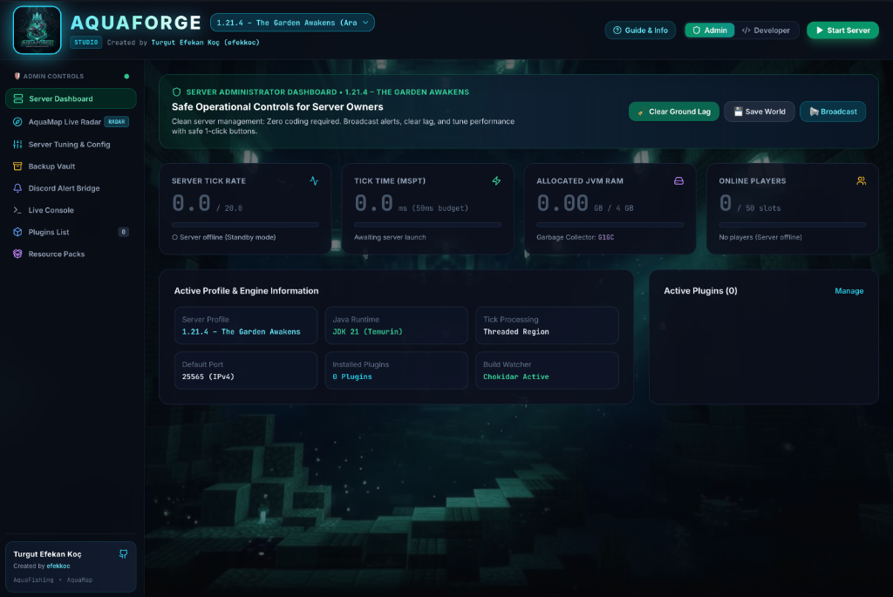
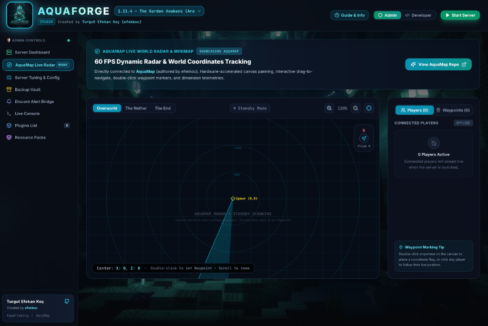

<div align="center">

# ⚡ AquaForge
### Next-Gen Minecraft Server Orchestrator, Plugin Diagnostic Engine & Marketplace Hub

[](https://papermc.io)
[](https://www.oracle.com/java/)
[](https://www.typescriptlang.org/)
[](https://react.dev/)
[](https://tailwindcss.com/)
[](LICENSE)

<br/>



<p align="center">
  <b>AquaForge</b> is an all-in-one developer studio and server orchestrator built for high-performance Minecraft (Paper/Purpur) networks.<br/>
  Engineered specifically for plugin developers and network administrators to eliminate the friction of debugging, deploying, and monitoring Paper 1.21+ plugins.
</p>

[Key Features](#-key-features) • [AquaMap Radar](#-aquamap-live-world-radar) • [Architecture](#-architecture) • [Getting Started](#-getting-started) • [Ecosystem Plugins](#-the-aqua-ecosystem-plugins) • [Author](#-author)

---

</div>

## 🌟 Key Features

### 🗺️ 1. AquaMap 60 FPS Live World Radar & Minimap
- **Hardware-Accelerated Canvas**: Ultra-smooth 60 FPS pan-and-scan world radar powered by HTML5 Canvas.
- **Double-Click Waypoint Placement**: Double-click anywhere on the radar canvas to drop coordinate waypoints with custom color tags and labels.
- **Interactive Compass HUD**: Top-right compass button aligns radar to North and recenters instantly on World Spawn `(0,0)`.
- **Dimension Switching**: Seamless multi-world rendering across Overworld, The Nether, and The End.
- **Clean Telemetry**: Standby mode with zero phantom entities when the server is offline.

<div align="center">
  
</div>

<br/>

### 🔍 2. Real-Time Stack Trace Diagnostic Studio (Bug Hunter)
- **Automatic Exception Interception**: Real-time log parser intercepts crashes and unhandled exceptions (`NullPointerException`, `ConcurrentModificationException`, `EventException`, `ClassNotFoundException`, `ScannerException`).
- **Culprit Isolation**: Pinpoints the exact plugin, Java package, source file, and line number (e.g., `PlayerFishListener.java:84`).
- **AI / Rule-Based Code Patching**: Generates production-ready Java code suggestions with defensive null-checks, concurrent collections, or Aikar flag recommendations.
- **Exportable Reports**: 1-click Markdown bug export for issue trackers and dev team handoffs.

### ⚡ 3. Live Dev-Sync & Hot-Swap (Watch Daemon)
- **Eliminate Manual Drag & Drop**: Watches your plugin build directory (e.g., `AquaFishing/build/libs/`) via native file-system events (`chokidar`).
- **Instant Deployment**: As soon as `./gradlew build` completes on macOS/Windows, the compiled `.jar` is immediately synced to the server's `plugins/` directory.

### 📦 4. Plugin Vault & Marketplace (CurseForge / Modrinth Style)
- **Live Jar Inspection**: Directly parses `plugin.yml` and `paper-plugin.yml` from inside `.jar` files (extracting versions, main classes, API version, and dependencies).
- **1-Click Enable/Disable**: Toggle plugins without deleting files (`.jar` ⇋ `.jar.disabled`).
- **GitHub Releases Integration**: Automatically synchronizes releases from [`efekkoc/AquaFishing`](https://github.com/efekkoc/AquaFishing) and [`efekkoc/AquaMap`](https://github.com/efekkoc/AquaMap) with 1-click server deployment.
- **Modrinth Store**: Instant search and installation of essential community plugins (*LuckPerms, spark, WorldEdit, Chunky, ProtocolLib*).

### 🛠️ 5. Visual Properties Studio & Color-Coded MOTD Preview
- **No-Code Server Properties Editor**: Visual sliders and toggles for simulation distance, view distance, flight checks, and spawn protection.
- **Minecraft Formatting MOTD Editor**: Real-time live preview rendering `§` color codes into authentic pixel fonts.

### 💾 6. Backup Vault & 1-Click Snapshot Restore
- **Instant Zip Creation**: Creates point-in-time compressed snapshots of server worlds, configurations, and plugins.
- **1-Click Download & Rollback**: Revert configuration mishaps or corruptions effortlessly.

### 🔔 7. Discord Alert Bridge & Incident Webhooks
- **Incident Webhook Dispatcher**: Broadcasts critical server crashes, TPS drops, and anti-cheat alerts directly to Discord channels as rich embeds.

### 🧩 8. Plugin Dependency Matrix & Auto-Resolver
- **Deep Dependency Scanner**: Analyzes `depend` and `softdepend` declarations from `plugin.yml`, detecting missing libraries (Vault, ProtocolLib, LuckPerms) with 1-click installation.

### 💻 9. Bash-Style Terminal with Command History
- **`↑` / `↓` Arrow Key Navigation**: Cycles through previously executed commands with temp buffer preservation.
- **Quick Command Chips**: 1-click action triggers for `/tps`, `/spark health`, `/list`, `/save-all`, and `/help`.

### 📅 10. All-Era Minecraft Version Database (1989 – 2026)
- Full support for 35+ historical and upcoming Minecraft drops:
  - **Pre-Classic & Classic (2009)**
  - **Alpha & Beta (2010 – 2011)**
  - **Classic 1.x Era (1.0 to 1.20)**
  - **Game Drops Era (1.21.3 Bundles of Bravery, 1.21.4 The Garden Awakens, 1.21.5 Spring to Life, 1.21.11 Mounts of Mayhem)**
  - **New Calendar-Based System (2026.1 Tiny Takeover, 2026.2 Chaos Cubed, 2026.3 Wilderness Bound)**

---

## 🏛 Architecture

```
aquaforge/
├── server/                   # Node.js + TypeScript Backend Orchestrator
│   ├── src/
│   │   ├── services/
│   │   │   ├── DiagnosticEngine.ts      # Stack trace parser & Java code advisor
│   │   │   ├── ServerProcessManager.ts  # ChildProcess manager (Paper/Purpur)
│   │   │   ├── PluginManager.ts         # AdmZip plugin.yml reader & toggle
│   │   │   ├── MarketplaceService.ts    # GitHub API & Modrinth proxy
│   │   │   ├── DevSyncService.ts        # Chokidar file watcher daemon
│   │   │   ├── ConfigInspector.ts       # YAML validator & indentation fixer
│   │   │   ├── BackupService.ts         # Snapshot zip & restore manager
│   │   │   ├── DiscordWebhookService.ts # Incident webhook dispatcher
│   │   │   ├── DependencyService.ts     # Plugin matrix & dependency resolver
│   │   │   └── ResourcePackService.ts   # SHA-1 checksum & HTTP CDN
│   │   ├── types.ts                     # Strongly-typed schemas
│   │   └── index.ts                     # Express & WebSocket Server (Port 4000)
│   └── server_data/                     # Server root, plugins/, backups/
│
├── client/                   # React 18 + Vite + Tailwind CSS Frontend
│   ├── src/
│   │   ├── components/
│   │   │   ├── Header.tsx               # Server controls, version selector & HUD
│   │   │   ├── Sidebar.tsx              # Navigation & author attribution
│   │   │   ├── DashboardView.tsx        # TPS/MSPT dials & hardware metrics
│   │   │   ├── AquaMapRadarView.tsx     # 60 FPS Canvas Radar with Waypoints
│   │   │   ├── VisualPropertiesView.tsx # server.properties visual editor & MOTD
│   │   │   ├── BackupVaultView.tsx      # Snapshots & restore controls
│   │   │   ├── DiscordBridgeView.tsx    # Incident webhook manager
│   │   │   ├── DependencyMatrixView.tsx # Dependency scanner & 1-click resolver
│   │   │   ├── ConsoleView.tsx          # Colorized ANSI terminal with history
│   │   │   ├── DiagnosticsView.tsx      # Bug Hunter & code patch studio
│   │   │   └── PluginsView.tsx          # Plugin manager & marketplace
│   │   └── App.tsx                      # WebSocket client & routing
│   └── vite.config.ts
```

---

## 🚀 Getting Started

### Prerequisites
- **Node.js** v18+ (Node 20+ recommended)
- **Java 21 LTS** (for running actual Paper 1.21.x server instances)
- macOS, Linux, or Windows

### Installation

1. **Clone the repository:**
   ```bash
   git clone https://github.com/efekkoc/aquaforge.git
   cd aquaforge
   ```

2. **Install dependencies:**
   ```bash
   # Install server dependencies
   cd server && npm install

   # Install client dependencies
   cd ../client && npm install
   ```

3. **Start the Development Suite:**
   ```bash
   # From root:
   npm run dev

   # Or run concurrently in two terminals:
   # Terminal 1: cd server && npm run dev
   # Terminal 2: cd client && npm run dev
   ```

4. **Open in Browser:**
   ```
   http://localhost:5173
   ```

---

## 🎯 The Complete Aqua Ecosystem Suite

AquaForge provides **1-Click Ready Server Presets (Hazır Paketler)** and full integration with the complete 9-plugin arsenal authored by **Turgut Efekan Koç (efekkoc)**:

| Plugin | Version | Domain | Description |
|---|---|---|---|
| 🗺️ **[AquaMap](https://github.com/efekkoc/AquaMap)** | 1.20.x – 1.21.4 | Utility & Radar | Clientless 60 FPS live radar, minimap, double-click waypoints, and HUD compass engine. |
| 🛡️ **[AquaSecurity](https://github.com/efekkoc/AquaSecurity)** | 1.20.x – 1.21.4 | Security & 2FA | Enterprise RFC 6238 TOTP (Google Authenticator) & session lockdown guard for staff accounts. |
| 🔮 **[AquaRunes](https://github.com/efekkoc/AquaRunes)** | 1.20.x – 1.21.4 | Combat & RPG | Modern Data Components RPG weapon & armor rune matrix with rotating particle auras. |
| 🐕 **[AquaWatchdog](https://github.com/efekkoc/AquaWatchdog)** | 1.20.x – 1.21.4 | Anti-Cheat | Real-time sliding window CPS & raycast reach telemetry with Discord & AquaForge webhook triage. |
| 🏦 **[AquaEconomy](https://github.com/efekkoc/AquaEconomy)** | 1.20.x – 1.21.4 | Economy & Banking | Zero-lag in-memory financial engine, dual Wallet + Bank with interest, Vault API provider. |
| 🎁 **[AquaCrates](https://github.com/efekkoc/AquaCrates)** | 1.20.x – 1.21.4 | Loot & Rewards | 3D particle spiral animated loot boxes, pitch escalation sounds, and pity guarantee system. |
| 👮 **[AquaStaff](https://github.com/efekkoc/AquaStaff)** | 1.20.x – 1.21.4 | Moderation | Unified staff mode (/staff), silent vanish, suspect freeze lockdown, and live invsee inspector. |
| ⚔️ **[AquaDungeons](https://github.com/efekkoc/AquaDungeons)** | 1.20.x – 1.21.4 | MMO Arena | Procedural wave-based mob arenas, Trial Spawner boss encounters, and multi-phase BossBars. |
| 🎣 **[AquaFishing](https://github.com/efekkoc/AquaFishing)** | 1.20.x – 1.21.4 | Mini-Game | Advanced RPG fishing with 40 custom fish, reeling mini-game, 10 rod tiers & custom bossbars. |

---

## 📄 License

This project is licensed under the [MIT License](LICENSE) — free to use for personal, community, and enterprise Minecraft server networks.

Created with 💙 by **[Turgut Efekan Koç (efekkoc)](https://github.com/efekkoc)**.
